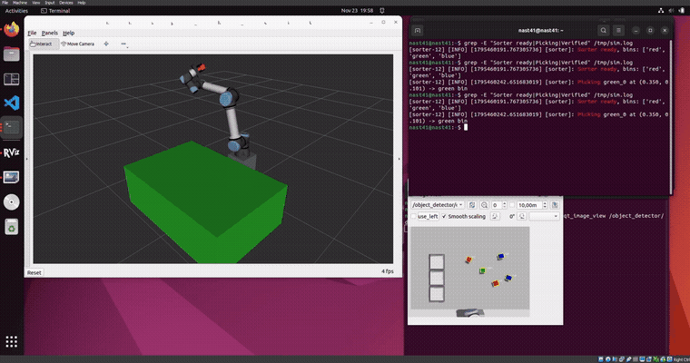
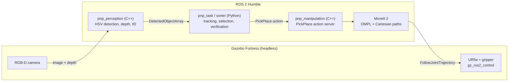

# Vision-Guided Pick-and-Place with ROS 2, MoveIt 2 and Gazebo


A UR5e with a parallel gripper uses an overhead RGB-D camera to find coloured cubes,
then sorts each cube into the bin of its colour, fully autonomously.
Perception and manipulation are written in C++; the task layer is in Python.



## Results

| Metric | Value |
| --- | --- |
| Cubes sorted autonomously | **6 / 6**, each placement confirmed by the camera |
| 3D detection accuracy vs. ground truth | **1–3 mm** |
| Gripper positioning at grasp | **≈ 5 mm** from cube centre |
| Automated tests | **29** (gtest + pytest) |

## Architecture



| Package | Language | Responsibility |
| --- | --- | --- |
| `pnp_interfaces` | IDL | `DetectedObject(Array)` messages and the `PickPlace` action |
| `pnp_description` | xacro | UR5e on a pedestal with a custom parallel gripper; mock or Gazebo hardware from one file |
| `pnp_moveit_config` | YAML / SRDF | Hand-written MoveIt 2 configuration |
| `pnp_perception` | C++ | Colour detection (HSV, red hue wrap-around, size/solidity/aspect filters), median depth, pinhole deprojection, tf2 to the world frame |
| `pnp_manipulation` | C++ | Symmetry-aware grasp planner (Eigen) and a staged MoveIt 2 `PickPlace` action server |
| `pnp_task` | Python | Sorting state machine with object tracking, retries and camera verification; controller activator; simulated grasp helper |
| `pnp_bringup` | launch / SDF | Gazebo world, models, bridge and the full system launch |

## Engineering decisions

- **ROS-free core libraries.** The detector and grasp geometry have no ROS dependency, so they're unit-tested in milliseconds with synthetic data.
- **Symmetry-aware grasping.** A cube looks identical every 90°, so the server tries all four grasp angles, the least wrist rotation first.
- **Verify, don't trust.** After each place, the arm moves out of the camera's view, and the task layer confirms the cube has left its pick spot. Failed picks are retried, then skipped.
- **Robust on modest hardware.** Developed on a CPU-only VM (simulation at ~0.4× real time). A custom controller activator retries until all controllers are active, instead of relying on one-shot spawners.
- **Reliable simulated grasps.** Friction grasps in simulation are fragile, so a Gazebo DetachableJoint holds the cube. A helper node attaches whichever cube is nearest the gripper, so the manipulation code needs no simulator-specific names.

## Quick start (Ubuntu 22.04 + ROS 2 Humble)

```bash
sudo apt install ros-humble-desktop ros-humble-moveit ros-humble-ur-description \
  ros-humble-ros-gz ros-humble-gz-ros2-control ros-humble-ros2-controllers
mkdir -p ~/pnp_ws && cd ~/pnp_ws
git clone https://github.com/subbu891/ros2_pick_and_place.git .
rosdep install --from-paths src --ignore-src -y
colcon build --symlink-install
source install/setup.bash
ros2 launch pnp_bringup sim.launch.py              # sorting starts automatically
```

| Command | What you get |
| --- | --- |
| `ros2 launch pnp_bringup sim.launch.py` | Full autonomous sorting (headless Gazebo + RViz) |
| `ros2 launch pnp_bringup sim.launch.py task:=false` | Everything except the autonomous task |
| `ros2 launch pnp_bringup sim.launch.py headless:=false` | With the Gazebo GUI (needs a GPU) |
| `ros2 launch pnp_moveit_config moveit_demo.launch.py` | MoveIt with mock hardware, no physics |

## Tests

```bash
colcon test && colcon test-result --verbose
```

## Roadmap

- [ ] Mobile manipulation: arm on a mobile base with Nav2 + SLAM
- [ ] Learned perception (YOLO trained on synthetic Gazebo images)
- [ ] Friction-based grasping without the attach helper

## License

Apache-2.0
